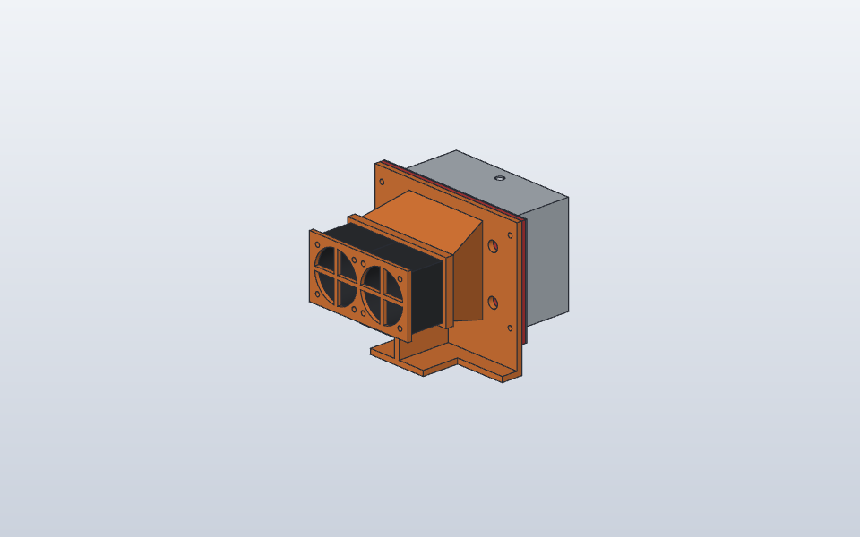
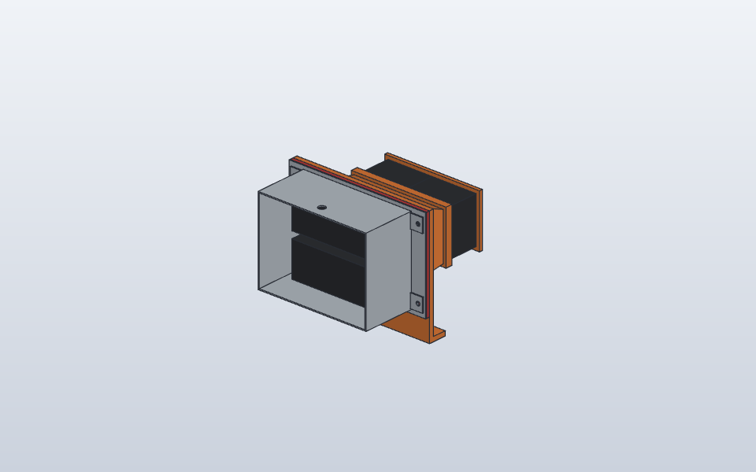

# Duct v1 (draft)

> **Status: cold-fit draft.** Geometry only; not yet printed, assembled or
> heated. Several input dimensions are estimates (see [Verify first](#verify-first)).
> Do not power the heaters in it before the checks in
> [docs/08-commissioning.md](../../docs/08-commissioning.md).

Floor-standing heater unit for the Panda Shelter. Air enters through a guard,
passes two fans **side by side** that feed one shared tunnel (ADR-019), a
printed taper, then a metal plate that holds both PTCs, and leaves through a
metal outlet box aimed low toward the chamber centre.

> **Both fans must run whenever a heater is on.** There are no backflow flaps
> yet, so a stopped fan lets the other fan's air leak back out of it. The
> firmware enforces this (`F_FAN_STALL`, `E_INTERLOCK`); flaps are a planned
> improvement (FMEA A16).




Orange = printed, red = gasket, grey = sheet metal, black = bought parts
(placeholders).

```
            ┌ fan 1 ┐
 intake → [guard]    ├→ [printed taper] → [gasket] → [metal plate + 2 PTC] → [metal outlet box] → chamber
            └ fan 2 ┘   77×37 → 60×60      thermal    hot zone: metal only    DS18B20 probe hole
   printed   side by side, 80×40           break
```

## Files

| File | What |
|---|---|
| `chamber-heater-duct.sc` | SolidCraft design, fully parametric (all sizes are named parameters) |
| `exports/transition.stl`, `.3mf` | Printed transition (taper, both flanges, feet) |
| `exports/fan-guard.stl` | Printed finger guard |
| `exports/duct-assembly.step` | Whole assembly incl. placeholders, for fit checks in other CAD |
| `templates/*.svg` | 1:1 cutting templates: PTC plate, gasket, outlet-box flat pattern |
| `templates/gen_templates.py` | Regenerates the templates (standard library only) |

## Parts

| Part | Material | Make | Notes |
|---|---|---|---|
| Transition | **ASA** (PETG acceptable for cold tests) | print | Upstream of the heaters: sees chamber air only |
| Fan guard | ASA / PETG | print | |
| Gasket | high-temp silicone sheet ~3 mm, or ceramic-fibre paper | cut by hand | Thermal break between printed flange and metal plate |
| PTC plate | scrap aluminium or steel, ~1 mm, 124 × 80 | cut + drill by hand | Holds both PTCs by their tabs; blocks air bypass |
| Outlet box | scrap sheet ~1 mm | cut + bend by hand | Strip 354 × 46 + 4 tabs (print the template on A3, or tile it) |
| 2 × fan | Nidec W40S12BS4A5-07 | bought | |
| 2 × PTC | (see Verify first) | bought | |

### Hardware

| Qty | Item | Where |
|---|---|---|
| 8 | M3 heat-set insert (Ø4 hole, ≤6 mm long) | fan flange of the transition (4 per fan) |
| 8 | M3 × ~35–40 socket screw | guard + fan + insert (3 + 28 + up to 6). Measure the fans' real depth first |
| 4 | M3 × 16 + nut + washer | clamp bolts: printed flange + gasket + plate + outlet-box tabs |
| 4 | M3 × 6 + nut | PTC tabs to the plate (nuts on the upstream side, in the 8 mm gasket/flange pockets) |
| 2+ | M3 screw or pop rivet | outlet-box seam |

## Print settings (Ender-3 V3 KE, 220 × 220 bed)

- **Transition:** print standing on the big PTC-side flange face (the flat 124 × 80 face down). In that orientation the taper walls lean at most about 19° from vertical, the sloped rib and base plate are vertical walls, and nothing needs support. Footprint about 124 × 100 mm, height 44 mm.
- **Fan guard:** flat, either face down.
- ASA, 4 perimeters, 30–40 % infill, enclosure closed. The heat-set inserts go into the fan-side flange after printing.

## Assembly order

1. Press the 4 heat-set inserts into the transition's fan flange.
2. Bolt both PTCs to the **downstream** face of the metal plate through their tabs (nuts upstream). The fins must line up with the two windows.
3. Fold the outlet box, close the seam, bend the 4 tabs outward.
4. Stack: transition flange → gasket → plate → outlet-box tabs. Clamp with the 4 M3 × 16 bolts.
5. Mount both fans side by side on the transition with the guard in front, 4 screws per fan. Both fans blow **toward** the heaters (check the arrow on the frame).
6. Mount the TCO on the outlet box close to the PTCs (clip or screw, metal-to-metal, with thermal paste). Push the DS18B20 through the 6 mm hole on top of the outlet box so its tip sits in the air stream.
7. Wire the PTCs and fans per [docs/04-wiring.md](../../docs/04-wiring.md). No wire may touch the fins or the outlet box edges.

## Verify first

These inputs are **not measured on your actual parts**. Check each one before
printing or cutting, and change the parameter in the CAD if it differs.

| Parameter | Value used | Source | Why it matters |
|---|---|---|---|
| `ptc_L`, `ptc_W`, `ptc_D`, `tab_L`, `tab_pitch` | 75.75, 30.5, 24.13, 92.5, 82 | Previous project's **220 V 50 W** PTC (photo measurements) | **This controller is designed for 12 V 100 W PTCs.** If your 12 V heaters are a different size, the plate, box and windows change |
| `win_L` × `win_W` | 54 × 19 | Estimated from the photo (fin length) and the handwritten 19.15 (fin width) | The windows must expose the fins and nothing else, or air bypasses the heater |
| Tab position | flush with one broad face | Assumed from the side photo | The PTC is assumed to sit flat on the plate |
| `fan_pitch` | 32 mm, Ø3.4 clearance | Typical for 40 × 40 fans; the W40S12BS4A5-07 drawing was not found | Fan screw holes and inserts |
| `fan_d` | 28 mm | Nidec product listing | Screw length |

## Design notes

- **Thermal separation.** The printed parts are only on the cold, upstream side. Everything downstream of the gasket is metal. The gasket and the M3 bolts are the only heat paths into the printed flange; check its temperature in commissioning.
- **No bypass.** The plate is a solid sheet with windows the size of the fin area, so all air goes through the fins. The taper's outlet (60 × 60) covers both windows.
- **Taper.** It goes from 77 × 37 (both fan openings) to 60 × 60 over 34 mm: narrowing about 14° per side horizontally, widening about 19° per side vertically. Flow may not be even across both PTCs; the fin resistance helps. Check with a hand on the outlet or a cheap anemometer.
- **Fans side by side, shared tunnel (ADR-019).** Either fan blows across both PTCs, but without flaps a stopped fan leaks air backwards, so heating always needs both fans.
- **Parametric.** Duct height (`Zc`), taper length and size, plate and box sizes, bolt positions and all PTC/fan sizes are named parameters. A trial change of `Zc`, `out_in`, `Lt` and `fan_d` rebuilt without errors.
- **Checks run:** volume of every stage matched the hand calculation; no overlaps between any parts (interference check); bolt holes line up through flange, gasket, plate and box tabs.

## Not done yet

- TCO clip and DS18B20 holder are notes only, not modelled.
- Cable routing and strain relief for the PTC and fan leads.
- Inlet filter, and a cover over the fan screws.
- Outlet direction: the box blows straight out horizontally; a downward deflector can be added once the unit's position in the shelter is known.
- Backflow flaps on the fans (next improvement, FMEA A16): would let one fan carry the heaters.
