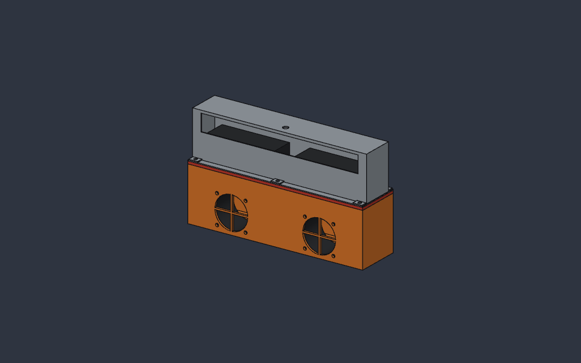
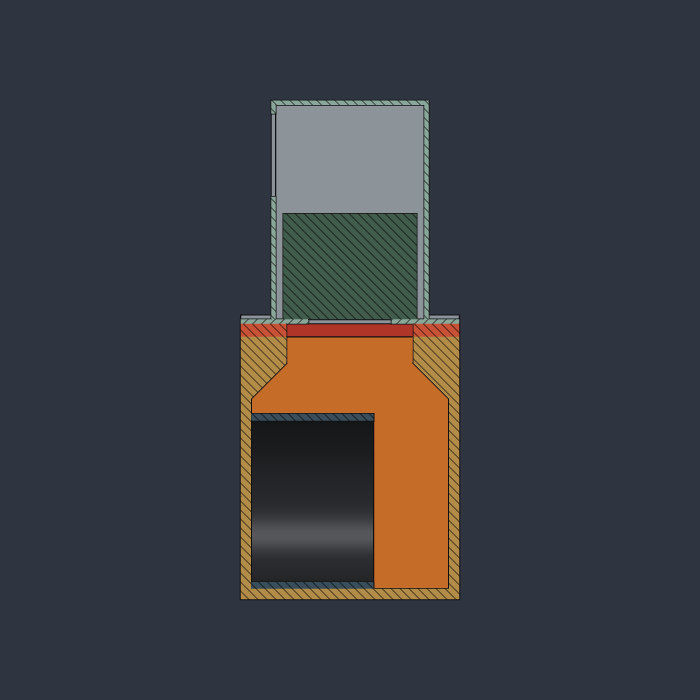

# Folded slab duct (draft)

> **Status: CAD draft.** Geometry only; not yet printed, assembled or heated.
> The PTC sizes are **placeholders from the previous project's 220 V 50 W
> heater**; the real 12 V 100 W parts have not arrived (see
> [Verify first](#verify-first)). Do not power the heaters in it before the
> checks in [docs/08-commissioning.md](../../../docs/08-commissioning.md).

A slim slab that stands against a wall, with the intake **and** the outlet on
the same front face. Air enters through the two fans low on the front, blows to
the back, turns up through the two PTCs, and turns again to leave through a
long window at the top of the front face.

> **Both fans must run whenever a heater is on** (ADR-019). The fans sit
> apart here, one under each PTC, but they share one plenum, so a stopped fan
> still lets the other fan's air leak back out of it. The firmware enforces
> this (`F_FAN_STALL`, `E_INTERLOCK`).




Orange = printed, red = gasket, grey = sheet metal, black = bought parts
(placeholders). The section is cut through the centre of one fan; the front
(−Y) is on the left.

```
            front face                 back
 hot air ← [hood outlet] ←──┐          metal hood, DS18B20 in the roof
                           [PTC]       on the metal plate (hot zone: metal only)
                           [gasket]    thermal break
                     ┌──────┘ ↑        printed lip, 45° wedges underneath
 cool air → [fan] → rear plenum ┘      fans blow to the back, air turns up
```

**Size:** 196 mm wide, 50 mm deep, 114 mm tall (about 1.1 L). The depth is
set by the fan (28 mm) plus a 17 mm rear plenum and walls; the width by the two
PTCs placed end to end (their 92.5 mm tabs).

## Trade-offs against the vertical design

- **Slimmer, but wider.** 50 mm deep instead of 86, but 196 mm wide instead of 100.
- **Two turns.** Fan → up, and hood → front. Each turn costs some fan pressure,
  so expect a little less airflow (and so a little less PTC output) than the
  vertical design.
- **Recirculation.** The outlet is about 50 mm above the intake on the same
  face, so some hot air can go straight back into the fans. That raises the
  fans' intake temperature, which matters in dry mode (fans rated to 70 °C,
  dry mode capped at 65 °C). Measure the air temperature at the fan intake
  during commissioning, and add a deflector on the outlet if it runs hot.
- **Heat soak.** The PTCs sit above the fans, so residual heat still rises
  away from the fans after a stop.

## Files

| File | What |
|---|---|
| `duct-folded.sc` | SolidCraft design, fully parametric (every size is a named parameter) |
| `exports/fan-box.stl`, `.3mf` | Printed fan box: front wall with fan openings, rear plenum, top lip |
| `exports/duct-assembly.step` | Whole assembly including placeholders, for fit checks in other CAD |
| `templates/*.svg` | 1:1 cutting templates: PTC plate, gasket, hood flat pattern |
| `templates/gen_templates.py` | Regenerates the templates (standard library only) |

## Parts

| Part | Material | Make | Notes |
|---|---|---|---|
| Fan box | **ASA** (PETG acceptable for cold tests) | print | Fans inside, behind the front wall |
| Gasket | high-temp silicone sheet ~3 mm, or ceramic-fibre paper | cut by hand | 196 × 50 frame, window 191.2 × 29. The end strips are only 2.4 mm wide: cut carefully |
| PTC plate | scrap aluminium or steel, ~1 mm, 196 × 50 | cut + drill by hand | Holds both PTCs by their tabs; windows = fin area |
| Hood | scrap sheet ~1 mm | cut + bend by hand | Flat pattern 293 × 148 (print on A3 landscape) |
| 2 × fan | Nidec W40S12BS4A5-07 | bought | |
| 2 × PTC | (see Verify first) | bought | |

### Hardware

| Qty | Item | Where |
|---|---|---|
| 6 | M3 heat-set insert (Ø4 hole, ≤6 mm long) | top lip, for the clamp screws |
| 8 | M3 × 35 screw + nut | fans to the front wall (through the wall and the fan frame, nut behind the fan) |
| 6 | M3 × 10 screw + washer | clamp: hood tab, plate, gasket, into the lip inserts |
| 4 | M3 × 6 + nut | PTC tabs to the plate (nuts underneath, inside the gasket window) |
| 8 | pop rivet or M3 screw + nut | hood corner flaps |

## Print settings (Ender-3 V3 KE, 220 × 220 bed)

- **Fan box:** floor on the bed. Footprint 196 × 50 mm, height 60 mm. The lip
  is carried by 45° wedges and the fan openings are in a vertical wall, so
  nothing needs supports.
- ASA, 4 perimeters, 30–40 % infill, enclosure closed. Heat-set inserts go in
  after printing.

## Assembly order

1. Press the 6 heat-set inserts into the top of the lip.
2. Lower each fan through the 29 mm lip opening (the fans are 28 mm deep, so
   it is a close fit), down to the floor, then slide it forward against the
   front wall. Fans blow **toward the back** (check the arrow on the frame).
3. Screw each fan to the front wall with 4 × M3 × 35, nuts behind the fan
   frame. Placing the nuts in the rear plenum is fiddly; use tweezers.
4. Bolt both PTCs onto the **top** of the metal plate through their tabs,
   nuts underneath.
5. Fold the hood: walls down, corner flaps onto the front and back walls,
   rivet. Bend the 6 clamp tabs outward, then drill their holes.
6. Stack: fan-box lip → gasket → plate → hood tabs. Clamp with 6 × M3 × 10
   into the lip inserts.
7. Mount the TCO on a hood wall at PTC height, close to the fins
   (metal-to-metal with thermal paste). Push the DS18B20 through the 6 mm hole
   in the roof so its tip sits in the air stream.
8. Wire the PTCs and fans per [docs/04-wiring.md](../../../docs/04-wiring.md).
   Route leads so that no wire touches the fins or a sheet-metal edge.

## Verify first

These inputs are **not measured on your actual parts**. Check each one before
printing or cutting, and change the parameter in the CAD (and in
`templates/gen_templates.py`) if it differs.

| Parameter | Value used | Source | Why it matters |
|---|---|---|---|
| `ptc_L`, `ptc_W`, `ptc_D`, `tab_L`, `tab_pitch` | 75.75, 30.5, 24.13, 92.5, 82 | Previous project's **220 V 50 W** PTC | Sets the plate, the hood, the width and the depth |
| `tab_w` | 10 | Guess | Hood clearance |
| `win_L` × `win_W` | 54 × 19 | Estimated fin area | The windows must expose the fins and nothing else |
| `fan_pitch` | 32 mm | Typical for 40 × 40 fans | Fan screw holes in the front wall |
| `fan_d` | 28 mm | Nidec listing | Slab depth, lip opening (`opY` must stay larger) and screw length |

When the real PTCs arrive, change `ptc_*`, `tab_*` and `win_*`, then `W`,
`hood_inX`, `hood_inY`, `bolt_xe` and `bolt_y` so the hood clears the tabs and
housings and the clamp bolts stay outside the hood wall. If the PTC housing is
wider than about 34 mm, `D` has to grow as well.

## Design notes

- **One fan under each PTC.** The fans sit at X = ±49.25 mm, under the PTC
  centres, so each PTC gets an even feed. They still share one plenum.
- **Fan guard.** The front-wall openings have a printed cross only, like the
  horizontal design's guard. A finer grille in front is recommended where
  fingers can reach it.
- **Outlet.** One 176 × 19 mm window at the top of the front face (about
  3300 mm², more than the fin area). To aim it elsewhere, move the window on
  the hood flat pattern.
- **Thermal separation.** Plastic only upstream of the gasket, as in ADR-018.
  The gasket and the M3 clamp screws are the only heat paths into the printed lip.
- **Parametric.** A trial change of `W`, `D`, `plen`, `hood_H`, `ptc_gap`,
  `hood_inX` and `bolt_xe` rebuilt without errors.
- **Checks run:** the volume of every body matched the hand calculation
  (to 0.1 mm³); the interference check found no overlap between any of the
  8 bodies.

## Not done yet

- TCO clip and DS18B20 holder are notes only, not modelled.
- Cable exits and strain relief.
- Wall-mounting features (keyhole slots on the back) for a specific host.
- An outlet deflector to keep hot air away from the intake.
- Backflow flaps on the fans (FMEA A16).
