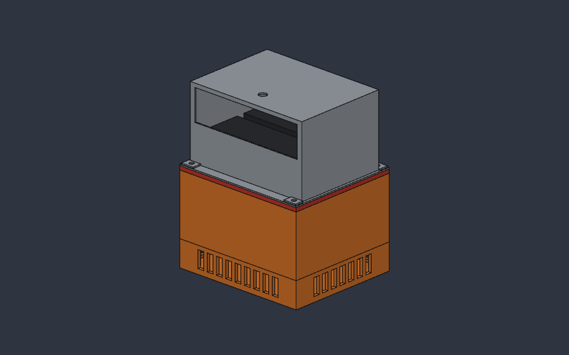
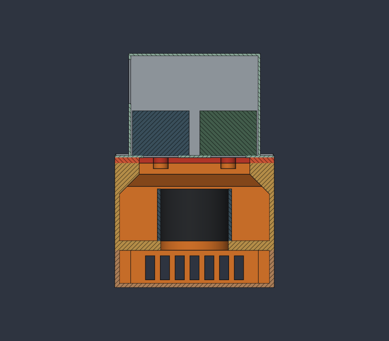

# Vertical upflow duct (draft)

> **Status: CAD draft.** Geometry only; not yet printed, assembled or heated.
> The PTC sizes are **placeholders from the previous project's 220 V 50 W
> heater**; the real 12 V 100 W parts have not arrived (see
> [Verify first](#verify-first)). Do not power the heaters in it before the
> checks in [docs/08-commissioning.md](../../../docs/08-commissioning.md).

A compact tower for dryer boxes and small enclosures. Air comes in through
slots around the base, goes **straight up** through two fans side by side, the
two PTCs and a metal hood, and leaves through a window in one side of the hood.
There is no forced turn between the fans and the heaters.

> **Both fans must run whenever a heater is on** (ADR-019). There are no
> backflow flaps, so a stopped fan lets the other fan's air leak back out of
> it. The firmware enforces this (`F_FAN_STALL`, `E_INTERLOCK`).




Orange = printed, red = gasket, grey = sheet metal, black = bought parts
(placeholders). The section is cut through the centre of one fan.

```
 hot air ←  [metal hood, side outlet]       DS18B20 in the roof, TCO on a hood wall
              ↑
          [2 PTC on metal plate]            hot zone: metal only
          [gasket]                          thermal break
          [printed lip + plenum]            45° wedges under the lip, prints without supports
              ↑
          [2 fans side by side, blowing up] sit on the fan deck (pressure wall)
          [printed inlet base]              side slots, 5 mm wide (finger-safe)
 cool air → slots on all four sides
```

**Size:** 100 × 86 mm footprint, 126 mm tall (about 1.1 L, half the
horizontal design's 2.1 L). With the placeholder PTCs, the footprint is set by
the PTC tab length (92.5 mm) in X and by two PTCs side by side (67 mm) plus the
hood and clamp bolts in Y, not by the fans.

## Why upward flow

- **The fans breathe the coolest air.** The intake is at the bottom of the box
  or chamber. That matters because the fans are rated to 70 °C, which is what
  caps dry mode at 65 °C.
- **Heat soaks away from the fans.** After a stop or a fault, residual heat
  from the PTCs rises out of the hood instead of into the fans and the printed
  parts. A stalled fan still leaves some natural draught over the fins.
- **No forced turn before the heaters.** The only turns are at the intake
  (slow, cold air) and at the outlet.

## Files

| File | What |
|---|---|
| `duct-vertical.sc` | SolidCraft design, fully parametric (every size is a named parameter) |
| `exports/shroud.stl` | Printed shroud: fan deck, walls, top lip |
| `exports/inlet-base.stl` | Printed inlet base: intake slots, corner screw posts |
| `exports/printed-parts.3mf` | Both printed parts |
| `exports/duct-assembly.step` | Whole assembly including placeholders, for fit checks in other CAD |
| `templates/*.svg` | 1:1 cutting templates: PTC plate, gasket, hood flat pattern |
| `templates/gen_templates.py` | Regenerates the templates (standard library only) |

## Parts

| Part | Material | Make | Notes |
|---|---|---|---|
| Shroud | **ASA** (PETG acceptable for cold tests) | print | Fans sit inside it; its lip carries the gasket |
| Inlet base | ASA / PETG | print | Cold side only |
| Gasket | high-temp silicone sheet ~3 mm, or ceramic-fibre paper | cut by hand | 100 × 86, window 82 × 60 |
| PTC plate | scrap aluminium or steel, ~1 mm, 100 × 86 | cut + drill by hand | Holds both PTCs by their tabs; windows = fin area, so no bypass |
| Hood | scrap sheet ~1 mm | cut + bend by hand | Flat pattern 204 × 193 (print on A3) |
| 2 × fan | Nidec W40S12BS4A5-07 | bought | |
| 2 × PTC | (see Verify first) | bought | |

### Hardware

| Qty | Item | Where |
|---|---|---|
| 16 | M3 heat-set insert (Ø4 hole, ≤5 mm long) | 8 in the fan deck (top), 4 in the fan deck (underside), 4 in the lip |
| 8 | M3 × 30–35 socket screw | fans to the deck. Measure the fans' real depth first |
| 4 | M3 × 20 socket screw | inlet base to the shroud, from underneath (counterbored) |
| 4 | M3 × 10 screw + washer | clamp: hood tab, plate, gasket, into the lip inserts |
| 4 | M3 × 6 + nut | PTC tabs to the plate (nuts underneath, in the lip pockets) |
| 8 | pop rivet or M3 screw + nut | hood corner flaps |

## Print settings (Ender-3 V3 KE, 220 × 220 bed)

- **Shroud:** fan deck on the bed. The walls go straight up and the lip is
  carried by 45° wedges, so nothing needs supports. Footprint 100 × 86 mm,
  height 47 mm.
- **Inlet base:** floor on the bed. The slot tops bridge 5 mm. Height 20 mm.
- ASA, 4 perimeters, 30–40 % infill, enclosure closed. Heat-set inserts go in
  after printing.

## Assembly order

1. Press the 16 heat-set inserts into the shroud: 8 into the top of the fan
   deck, 4 into the underside of the deck at the corners, 4 into the top of the lip.
2. Lower both fans through the lip opening onto the deck, **blowing up**,
   away from the deck (check the arrow on the frame). Screw each one down
   with 4 screws.
3. Screw the inlet base onto the underside of the shroud (4 × M3 × 20 from below).
4. Bolt both PTCs onto the **top** of the metal plate through their tabs,
   nuts underneath. The fins must line up with the two windows.
5. Fold the hood: walls down, corner flaps onto the front and back walls,
   rivet. Bend the 4 clamp tabs outward, then drill their holes.
6. Stack: shroud lip → gasket → plate (the tab nuts sit in the gasket holes
   and the lip pockets) → hood tabs. Clamp with 4 × M3 × 10 into the lip inserts.
7. Mount the TCO on a hood wall at PTC height, as close to the fins as you can
   (metal-to-metal with thermal paste). Push the DS18B20 through the 6 mm hole
   in the roof so its tip sits in the air stream above the PTCs.
8. Wire the PTCs and fans per [docs/04-wiring.md](../../../docs/04-wiring.md).
   Route leads so that no wire touches the fins or a sheet-metal edge.

## Verify first

These inputs are **not measured on your actual parts**. Check each one before
printing or cutting, and change the parameter in the CAD (and in
`templates/gen_templates.py`) if it differs.

| Parameter | Value used | Source | Why it matters |
|---|---|---|---|
| `ptc_L`, `ptc_W`, `ptc_D`, `tab_L`, `tab_pitch` | 75.75, 30.5, 24.13, 92.5, 82 | Previous project's **220 V 50 W** PTC | Sets the plate, the hood and the whole footprint |
| `tab_w` | 10 | Guess | Tab nut pockets and hood clearance |
| `win_L` × `win_W` | 54 × 19 | Estimated fin area | The windows must expose the fins and nothing else, or air bypasses the heater |
| `fan_pitch` | 32 mm | Typical for 40 × 40 fans | Fan screw inserts in the deck |
| `fan_d` | 28 mm | Nidec listing | Shroud height and screw length |

When the real PTCs arrive, change `ptc_*`, `tab_*` and `win_*`, then
`W`, `D`, `hood_inX`, `hood_inY`, `bolt_x`, `bolt_y` so the hood clears the
tabs and housings and the clamp bolts stay outside the hood wall.

## Design notes

- **One pressure wall.** The fan deck separates the intake (below) from the
  pressurised plenum (above). The fans sit inside the plenum; the only way
  out is through the plate windows, so no air bypasses the fins.
- **Intake area.** 32 slots of 5 × 13 mm give about 2080 mm², close to the
  two fan bores (about 2150 mm²). Keep the slots clear: the base needs a few
  centimetres of free space around it.
- **Fan-to-fin distance** is 18 mm, so the fan hubs do not shadow the middle
  of the fins.
- **Outlet.** One 88 × 24 mm window in the front (−Y) wall of the hood, about
  the same area as the fins (2052 mm²). To aim the air elsewhere, move the
  window to another wall or open the roof: that changes only the hood flat
  pattern.
- **Thermal separation.** Plastic only upstream of the gasket, as in ADR-018.
  The gasket and the M3 clamp screws are the only heat paths into the printed
  lip; check its temperature in commissioning.
- **Parametric.** A trial change of `W`, `D`, `hb`, `fan_d` and `hood_H`
  rebuilt without errors.
- **Checks run:** the volume of every body matched the hand calculation
  (to 0.01 mm³); the interference check found no overlap between any of the
  9 bodies.

## Not done yet

- TCO clip and DS18B20 holder are notes only, not modelled.
- Cable exits: the PTC leads leave through the hood or between the tabs; a
  grommet or slot is not modelled yet.
- Mounting features for a specific host (dryer box, printer) are not
  modelled; add them to the inlet base.
- Backflow flaps on the fans (FMEA A16).
